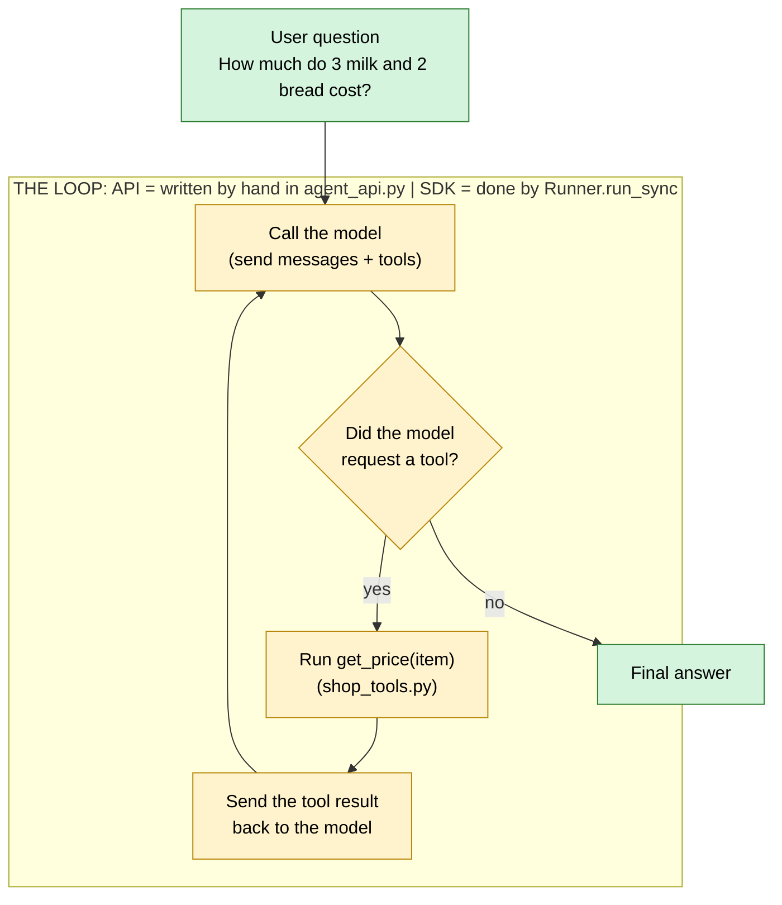

# PLAN: השוואת API מול SDK, סוכן "סל קניות"

## למה הסדר הזה?

בונים את אותו סוכן פעמיים: קודם עם OpenAI API ישירות, ואחר כך עם OpenAI Agents SDK.
הסדר הזה מכוון. בגרסת ה-API **אנחנו כותבים את הלולאה בעצמנו**: שולחים הודעה, בודקים אם המודל ביקש כלי, מריצים אותו, מחזירים תוצאה ושולחים שוב. אחרי שכתבנו את כל זה ביד ואנחנו מבינים כל שורה, עוברים ל-SDK **ורואים בדיוק מה הוא חוסך לנו**. אם היינו מתחילים מה-SDK, הלולאה הייתה "קסם" שאנחנו לא רואים.

כמו שלומדים לנהוג על הילוכים ידניים לפני אוטומט: אחרי שמבינים מתי מחליפים הילוך, מבינים מה האוטומט עושה בשבילנו.

---

## 1. הסבר על המערכת

### מה זה API ומה זה SDK?

- **API** הוא כמו להזמין במסעדה ישירות מהמטבח: אתה אומר בדיוק מה אתה רוצה, מקבל בדיוק את מה שביקשת, ואם צריך עוד מנה אתה הולך שוב. שליטה מלאה, אבל הכול עליך.
  בפועל: קוראים ל-`client.chat.completions.create(...)` ומקבלים תשובה אחת. כל השאר, כמו זיכרון השיחה, הרצת כלים ולולאה, כותבים בעצמנו.
- **SDK** (Software Development Kit) הוא כמו מלצר: אומרים לו מה רוצים בסוף, והוא כבר מתרוצץ בין המטבח לשולחן כמה פעמים שצריך. פחות עבודה, אבל פחות רואים מה קורה מאחורי הקלעים.
  בפועל: מגדירים `Agent` עם כלים, קוראים ל-`Runner.run_sync(...)`, וה-SDK מנהל את הלולאה.

### מה הסוכן עושה?

המשתמשת שואלת למשל: `How much do 3 milk and 2 bread cost?`

לסוכן יש כלי אחד, `get_price(item: str)`, שמחזיר את המחיר של מוצר מתוך מילון קבוע `PRICES` (15 מוצרים). אם המוצר לא קיים, הכלי מחזיר הודעה כמו `Item 'pizza' not found`.

המודל מבין אילו מוצרים יש בשאלה, קורא לכלי עבור כל מוצר, מכפיל בכמויות, מחבר ועונה, למשל: `3 milk and 2 bread cost 8.50`.

### תרשים הלולאה



**מקרא:**
- ירוק (שאלה ותשובה, וגם הפונקציה `get_price` עצמה): כותבים בשתי הגרסאות.
- צהוב (הלולאה): **ב-API כותבים ביד**: רשימת `messages`, בדיקת `tool_calls`, הרצת הכלי, הוספת הודעת `tool`, וקריאה חוזרת. **ב-SDK** כל המלבן הצהוב הוא שורה אחת: `Runner.run_sync(agent, question)`.

---

## 2. מבנה הקבצים

| קובץ | הסבר |
|---|---|
| `requirements.txt` | הספריות: `openai`, `openai-agents`, `python-dotenv`, `streamlit`. |
| `.env.example` | תבנית למשתני סביבה: `OPENAI_API_KEY`, `OPENAI_MODEL`. מעתיקים ל-`.env` וממלאים. |
| `shop_tools.py` | המילון `PRICES` והפונקציה `get_price`. משותף לשני הסוכנים, כדי שהכלי יהיה זהה. |
| `agent_api.py` | הסוכן עם קריאות API ישירות: תיאור כלי ב-JSON ביד, `messages` ביד, לולאה ביד. |
| `agent_sdk.py` | אותו סוכן עם Agents SDK: `@function_tool` ו-`Runner.run_sync`. |
| `COMPARISON.md` | טבלת השוואה שממלאים אחרי ההרצות. |
| `app.py` | ממשק Streamlit שעוטף את שני הסוכנים: מקלידים שאלה, בוחרים API, SDK או שניהם, ורואים תשובה, קריאות וטוקנים זה לצד זה. |

### החוזה המשותף: `run_agent(question)`
כדי ש-`app.py` יוכל לעטוף את שני הסוכנים בלי לדעת איך הם בנויים, בשני הקבצים תהיה פונקציה בשם `run_agent(question)` שמחזירה **מילון באותו מבנה בדיוק**:

```python
{
    "answer": "3 milk and 2 bread cost 8.50",
    "calls": [  # רשומה אחת לכל קריאה למודל
        {"call": 1, "tools": ["get_price(item='milk')", "get_price(item='bread')"], "tokens": 152},
        {"call": 2, "tools": [], "tokens": 98},
    ],
    "num_calls": 2,
    "total_tokens": 250,
}
```

`run_agent` ממשיכה להדפיס לטרמינל כמו קודם, ו-`main()` רק קוראת לה עם `QUESTION`. ככה `python agent_api.py` עובד כמו קודם, ו-`app.py` מקבל נתונים מסודרים להצגה.

הערה: את `.env` (עם המפתח האמיתי) לא מעלים ל-git ולא משתפים.

---

## 3. השלבים

כל שלב יוצר או משנה **קובץ אחד לכל היותר**. אחרי כל שלב בודקים ורק אז ממשיכים.

> הכנה חד-פעמית ב-PowerShell (לפני Phase 0 או אחריו):
> ```powershell
> python -m venv .venv
> .\.venv\Scripts\Activate.ps1
> ```

### Phase 0: `requirements.txt` ו-`.env.example`
**הערה:** זה השלב היחיד עם שני קבצים, ושניהם קבצי הגדרות קצרים בלי קוד.

- **מטרה:** להגדיר את הספריות ואת משתני הסביבה שהפרויקט צריך.
- **קבצים:** `requirements.txt`, `.env.example`
- **איך בודקים:**
  ```powershell
  pip install -r requirements.txt
  Copy-Item .env.example .env
  notepad .env   # למלא OPENAI_API_KEY ו-OPENAI_MODEL
  pip show openai openai-agents streamlit
  ```
  **מה אמור לצאת:** ההתקנה מסתיימת בלי שגיאות, ו-`pip show` מציג את שלוש החבילות עם מספר גרסה.

### Phase 1: `shop_tools.py`
- **מטרה:** לכתוב את מילון המחירים ואת הכלי `get_price`, בלי שום קשר למודל.
- **קובץ:** `shop_tools.py`
- **איך בודקים:**
  ```powershell
  python -c "from shop_tools import get_price; print(get_price('milk')); print(get_price('Milk ')); print(get_price('pizza'))"
  ```
  **מה אמור לצאת:** מחיר החלב פעמיים (הפונקציה מתעלמת מאותיות גדולות ומרווחים), ואז ההודעה `Item 'pizza' not found`.

### Phase 2: `agent_api.py`, חלק א': קריאה פשוטה אחת
- **מטרה:** להכיר את ה-API: לשלוח שאלה אחת למודל, בלי כלים, ולהדפיס תשובה וטוקנים.
- **קובץ:** `agent_api.py`
- **איך בודקים:**
  ```powershell
  python agent_api.py
  ```
  **מה אמור לצאת:** שורה כמו `--- Model call #1 ---`, תשובה טקסטואלית מהמודל (הוא לא יודע את המחירים, אז ינחש או יגיד שאין לו מידע), ושורת טוקנים: `prompt / completion / total`.

### Phase 3: `agent_api.py`, חלק ב': כלי ולולאה ידנית
- **מטרה:** להוסיף את תיאור הכלי ב-JSON ואת הלולאה הידנית, כך שהמודל יקבל מחירים אמיתיים.
- **קובץ:** `agent_api.py` (שינוי)
- **איך בודקים:**
  ```powershell
  python agent_api.py
  ```
  **מה אמור לצאת:**
  - קריאה #1: המודל מבקש `get_price` עם `item='milk'` ועם `item='bread'` (לפעמים שתי בקשות באותה קריאה, לפעמים בקריאות נפרדות).
  - קריאה #2 (או #3): אין בקשת כלי, יש תשובה סופית עם המחיר הנכון לפי `PRICES`.
  - טוקנים לכל קריאה, ובסוף שורת סיכום: מספר קריאות וסך הטוקנים.

### Phase 4: `agent_sdk.py`
- **מטרה:** לבנות את אותו סוכן עם Agents SDK ולהדפיס את אותו מידע.
- **קובץ:** `agent_sdk.py`
- **איך בודקים:**
  ```powershell
  python agent_sdk.py
  ```
  **מה אמור לצאת:** אותה תשובה סופית כמו ב-Phase 3, הדפסה של כל קריאה למודל ושל בקשות הכלי, וסיכום טוקנים כולל ומספר קריאות.

### Phase 5: `COMPARISON.md`
- **מטרה:** ליצור תבנית טבלה ריקה להשוואה, שאמלא בעצמי אחרי שאריץ את שני הסוכנים.
- **קובץ:** `COMPARISON.md`
- **איך בודקים:**
  ```powershell
  (Get-Content agent_api.py | Measure-Object -Line).Lines
  (Get-Content agent_sdk.py | Measure-Object -Line).Lines
  python agent_api.py
  python agent_sdk.py
  ```
  **מה אמור לצאת:** הקובץ נפתח ב-VS Code עם טבלה ריקה, ומהפקודות האלה ממלאים את מספר השורות, מספר הקריאות וסך הטוקנים.

### Phase 6: `app.py` (ממשק Streamlit)
- **מטרה:** לעטוף את שני הסוכנים בממשק דפדפן פשוט ולהשוות אותם זה לצד זה.
- **קובץ:** `app.py`
- **איך בודקים:**
  ```powershell
  streamlit run app.py
  ```
  **מה אמור לצאת:** הדפדפן נפתח בכתובת `http://localhost:8501`. רואים תיבת טקסט עם השאלה כברירת מחדל, בחירה בין `API`, `SDK` ו-`Both`, וכפתור `Run`. אחרי לחיצה על `Both` מופיעות שתי עמודות, ובכל אחת: התשובה הסופית, טבלת קריאות (מספר קריאה, כלים שהתבקשו, טוקנים), ומספר הקריאות וסך הטוקנים. בטרמינל ממשיכות להופיע ההדפסות של שני הסוכנים.

  **מלכודת ידועה:** Streamlit מריץ את הסקריפט ב-thread שאין בו event loop של asyncio, ו-`Runner.run_sync` עלול להיכשל עם שגיאה כמו `There is no current event loop in thread 'ScriptRunner.scriptThread'`. אם זה קורה, הפתרון הוא ב-`app.py` בלבד: לפני הקריאה ל-`run_agent` של ה-SDK יוצרים event loop חדש (`asyncio.set_event_loop(asyncio.new_event_loop())`). את `agent_sdk.py` לא משנים.

---

## 4. פרומפטים מוכנים להעתקה

### פרומפט ל-Phase 0
```text
אתה מפתח תוכנה בכיר. כתוב קוד פשוט וקצר ככל האפשר, שסטודנטים יבינו בקלות. בלי מחלקות ובלי אבסטרקציות מיותרות.
מעל כל פונקציה כתוב הערה (comment עם #) בעברית פשוטה: מה הפונקציה עושה, מה היא מקבלת ומה היא מחזירה. בחלקים החשובים בתוך הפונקציה, הוסף הערה קצרה בשורה.

המשימה: Phase 0 מתוך PLAN.md.
צור שני קבצים:
1. requirements.txt עם השורות: openai, openai-agents, python-dotenv, streamlit (בלי נעילת גרסאות).
2. .env.example עם:
   OPENAI_API_KEY=your-key-here
   OPENAI_MODEL=gpt-4o-mini
   מעל כל משתנה, שורת הערה קצרה (#) בעברית שמסבירה מה הוא.
אל תתקין כלום ואל תיצור .env אמיתי.

בצע רק את השלב הזה. בסיום כתוב לי סיכום קצר בשלוש שורות: מה עשית, למה, ואיפה (באיזה קובץ ובאיזו פונקציה). אחר כך עצור וחכה לי.
```

### פרומפט ל-Phase 1
```text
אתה מפתח תוכנה בכיר. כתוב קוד פשוט וקצר ככל האפשר, שסטודנטים יבינו בקלות. בלי מחלקות ובלי אבסטרקציות מיותרות.
מעל כל פונקציה כתוב הערה (comment עם #) בעברית פשוטה: מה הפונקציה עושה, מה היא מקבלת ומה היא מחזירה. בחלקים החשובים בתוך הפונקציה, הוסף הערה קצרה בשורה.

המשימה: Phase 1 מתוך PLAN.md. צור את הקובץ shop_tools.py:
- מילון PRICES עם 15 מוצרים באנגלית ובאותיות קטנות, למשל: milk, bread, eggs, apple, cheese, עם מחירים כ-float.
- פונקציה get_price(item: str) שמנרמלת את הקלט (strip ו-lower), ומחזירה את המחיר (float) אם המוצר קיים.
  אם לא קיים, היא מחזירה מחרוזת קצרה: Item '<item>' not found (בלי רשימת המוצרים; הרשימה מוצגת בכפתור "Products" ב-app.py).
- בלי import של openai או של agents. הקובץ הזה הוא פייתון רגיל, ושני הסוכנים ייבאו ממנו.
- בלי בלוק if __name__ == "__main__".

בצע רק את השלב הזה. בסיום כתוב לי סיכום קצר בשלוש שורות: מה עשית, למה, ואיפה (באיזה קובץ ובאיזו פונקציה). אחר כך עצור וחכה לי.
```

### פרומפט ל-Phase 2
```text
אתה מפתח תוכנה בכיר. כתוב קוד פשוט וקצר ככל האפשר, שסטודנטים יבינו בקלות. בלי מחלקות ובלי אבסטרקציות מיותרות.
מעל כל פונקציה כתוב הערה (comment עם #) בעברית פשוטה: מה הפונקציה עושה, מה היא מקבלת ומה היא מחזירה. בחלקים החשובים בתוך הפונקציה, הוסף הערה קצרה בשורה.

המשימה: Phase 2 מתוך PLAN.md. צור את agent_api.py, חלק א': קריאה אחת פשוטה, בלי כלים.
לפני שאתה כותב קוד, בדוק בתיעוד העדכני של ספריית openai לפייתון (Chat Completions) את צורת הקריאה ואת שמות שדות ה-usage, כי ה-API משתנה בין גרסאות. ציין לי באיזו גרסה בדקת.
- טען את .env עם python-dotenv. קרא את OPENAI_MODEL ממשתני הסביבה.
- צור client = OpenAI().
- קבוע QUESTION = "How much do 3 milk and 2 bread cost?"
- רשימת messages שמנוהלת ביד: הודעת system קצרה והודעת user עם השאלה.
- קריאה אחת ל-client.chat.completions.create עם model ו-messages בלבד.
- הדפס: "--- Model call #1 ---", את תשובת המודל, ואת הטוקנים (prompt_tokens, completion_tokens, total_tokens).
- הכול בפונקציה main() אחת, עם if __name__ == "__main__": main().
- הדפסות באנגלית בלבד (כדי למנוע בעיות קידוד בטרמינל של Windows).

בצע רק את השלב הזה. בסיום כתוב לי סיכום קצר בשלוש שורות: מה עשית, למה, ואיפה (באיזה קובץ ובאיזו פונקציה). אחר כך עצור וחכה לי.
```

### פרומפט ל-Phase 3
```text
אתה מפתח תוכנה בכיר. כתוב קוד פשוט וקצר ככל האפשר, שסטודנטים יבינו בקלות. בלי מחלקות ובלי אבסטרקציות מיותרות.
מעל כל פונקציה כתוב הערה (comment עם #) בעברית פשוטה: מה הפונקציה עושה, מה היא מקבלת ומה היא מחזירה. בחלקים החשובים בתוך הפונקציה, הוסף הערה קצרה בשורה.

המשימה: Phase 3 מתוך PLAN.md. עדכן את agent_api.py, חלק ב': הוספת הכלי והלולאה הידנית.
לפני שאתה כותב קוד, בדוק בתיעוד העדכני של openai לפייתון את הפורמט של tools, של tool_calls ושל הודעת role="tool" ב-Chat Completions. ציין לי באיזו גרסה בדקת.
- ייבא את get_price מ-shop_tools.py. אל תשכפל את המחירים.
- תיאור הכלי ב-JSON כתוב ביד, במשתנה TOOLS (type "function", name, description, parameters עם item מסוג string).
- לולאה ידנית שקריאה וברורה (while עם מגבלה, למשל MAX_CALLS = 5):
  1. קריאה למודל עם messages ו-tools.
  2. הדפסה: "--- Model call #N ---" והטוקנים של הקריאה הזו.
  3. אם יש tool_calls: הוסף את הודעת המודל ל-messages. לכל tool_call הדפס את שם הכלי והפרמטר (למשל: Tool requested: get_price(item='milk')), הרץ את get_price, הדפס את התוצאה, והוסף הודעת tool עם tool_call_id ועם התוצאה כמחרוזת.
  4. אם אין tool_calls: הדפס "Final answer:" ואת התשובה, וצא מהלולאה.
- צבור את סך הטוקנים. בסוף הדפס: Total model calls ו-Total tokens (prompt / completion / total).
- שמור על אותה השאלה, אותו מודל מ-.env ואותה הודעת system כמו ב-Phase 2.
- העבר את הלולאה לפונקציה run_agent(question) שמדפיסה כמו שתואר למעלה, וגם מחזירה מילון במבנה של "החוזה המשותף: run_agent(question)" ב-PLAN.md (answer, calls, num_calls, total_tokens). main() רק קוראת ל-run_agent(QUESTION). הפונקציה הזו תשמש בהמשך את app.py (Streamlit).
- פונקציה קטנה run_tool(name, arguments) שמפענחת את ה-JSON של הפרמטרים וקוראת ל-get_price מותרת. מעבר ל-run_agent, ל-run_tool ול-main, בלי פונקציות נוספות.

בצע רק את השלב הזה. בסיום כתוב לי סיכום קצר בשלוש שורות: מה עשית, למה, ואיפה (באיזה קובץ ובאיזו פונקציה). אחר כך עצור וחכה לי.
```

### פרומפט ל-Phase 4
```text
אתה מפתח תוכנה בכיר. כתוב קוד פשוט וקצר ככל האפשר, שסטודנטים יבינו בקלות. בלי מחלקות ובלי אבסטרקציות מיותרות.
מעל כל פונקציה כתוב הערה (comment עם #) בעברית פשוטה: מה הפונקציה עושה, מה היא מקבלת ומה היא מחזירה. בחלקים החשובים בתוך הפונקציה, הוסף הערה קצרה בשורה.

המשימה: Phase 4 מתוך PLAN.md. צור את agent_sdk.py: אותו סוכן עם OpenAI Agents SDK (החבילה openai-agents, import מ-agents).
לפני שאתה כותב קוד, בדוק בתיעוד העדכני של openai-agents את: function_tool, Agent, Runner.run_sync, ואיך מוציאים מהתוצאה את רשימת הקריאות למודל (למשל raw_responses), את בקשות הכלי (new_items) ואת ה-usage (למשל context_wrapper.usage). ציין לי באיזו גרסה בדקת.
- טען .env, וקרא OPENAI_MODEL.
- עטוף את get_price מ-shop_tools.py בפונקציה עם @function_tool (עם docstring קצר באנגלית, כי ה-SDK משתמש בו כתיאור הכלי). אל תשכפל את המחירים.
- Agent עם אותן הוראות (instructions) כמו הודעת ה-system ב-agent_api.py, אותו מודל ואותו כלי.
- אותה QUESTION. ההרצה: result = Runner.run_sync(agent, QUESTION).
- אחרי ההרצה הדפס:
  - לכל קריאה למודל: "--- Model call #N ---", הכלים שהמודל ביקש עם הפרמטרים, והטוקנים של הקריאה אם הם זמינים.
  - "Final answer:" ואת result.final_output.
  - Total model calls ו-Total tokens (input / output / total).
- ההרצה וההדפסות יהיו בפונקציה run_agent(question), שגם מחזירה מילון באותו מבנה בדיוק כמו run_agent ב-agent_api.py (ראה "החוזה המשותף: run_agent(question)" ב-PLAN.md). main() רק קוראת ל-run_agent(QUESTION), עם if __name__ == "__main__": main(). הדפסות באנגלית בלבד.

בצע רק את השלב הזה. בסיום כתוב לי סיכום קצר בשלוש שורות: מה עשית, למה, ואיפה (באיזה קובץ ובאיזו פונקציה). אחר כך עצור וחכה לי.
```

### פרומפט ל-Phase 5
```text
אתה מפתח תוכנה בכיר. כתוב קוד פשוט וקצר ככל האפשר, שסטודנטים יבינו בקלות. בלי מחלקות ובלי אבסטרקציות מיותרות.
מעל כל פונקציה כתוב הערה (comment עם #) בעברית פשוטה: מה הפונקציה עושה, מה היא מקבלת ומה היא מחזירה. בחלקים החשובים בתוך הפונקציה, הוסף הערה קצרה בשורה.

המשימה: Phase 5 מתוך PLAN.md. צור את COMPARISON.md בעברית: תבנית טבלה ריקה בלבד (אני אמלא אותה אחרי ההרצות).
- עמודות: "קריטריון" | "agent_api.py" | "agent_sdk.py"
- שורות:
  1. מספר שורות קוד
  2. מספר קריאות למודל
  3. סך הטוקנים
  4. מה כתבתי ביד
  5. מה ה-SDK עשה בשבילי
  6. יתרונות
  7. חסרונות
- מתחת לטבלה: שורת הוראה עם פקודות PowerShell לספירת שורות: (Get-Content agent_api.py | Measure-Object -Line).Lines
- מתחת לזה: כותרת "מסקנה שלי" עם מקום ריק לכמה משפטים.
אל תמלא ערכים ואל תריץ את הסוכנים.

בצע רק את השלב הזה. בסיום כתוב לי סיכום קצר בשלוש שורות: מה עשית, למה, ואיפה (באיזה קובץ ובאיזו פונקציה). אחר כך עצור וחכה לי.
```

### פרומפט ל-Phase 6
```text
אתה מפתח תוכנה בכיר. כתוב קוד פשוט וקצר ככל האפשר, שסטודנטים יבינו בקלות. בלי מחלקות ובלי אבסטרקציות מיותרות.
מעל כל פונקציה כתוב הערה (comment עם #) בעברית פשוטה: מה הפונקציה עושה, מה היא מקבלת ומה היא מחזירה. בחלקים החשובים בתוך הפונקציה, הוסף הערה קצרה בשורה.

המשימה: Phase 6 מתוך PLAN.md. צור את app.py: ממשק Streamlit שעוטף את שני הסוכנים.
לפני שאתה כותב קוד, בדוק בתיעוד העדכני של Streamlit את הפונקציות שתשתמש בהן (למשל st.text_input, st.radio, st.button, st.columns, st.dataframe, st.metric, st.spinner). ציין לי באיזו גרסה בדקת.
- אל תשנה את agent_api.py, את agent_sdk.py או את shop_tools.py. רק תייבא:
  from agent_api import run_agent as run_api
  from agent_sdk import run_agent as run_sdk
  ושתיהן מחזירות מילון לפי "החוזה המשותף: run_agent(question)" ב-PLAN.md.
- כותרת לדף, ותיבת טקסט עם השאלה מ-QUESTION כברירת מחדל.
- בחירה (st.radio) בין "API", "SDK" ו-"Both".
- כפתור "Run". בזמן ההרצה הצג st.spinner.
- פונקציה show_result(title, result) שמציגה תוצאה אחת: כותרת, התשובה הסופית, טבלת קריאות (call, tools, tokens) ושני st.metric: מספר קריאות וסך טוקנים.
- ב-"Both": שתי עמודות עם st.columns(2), משמאל API ומימין SDK.
- כפתור "Products" (למשל ב-st.sidebar או עם st.popover) שמציג טבלה של כל המוצרים והמחירים מתוך PRICES ב-shop_tools.py. הרשימה מוצגת רק בממשק, ולא בתוך הפלט של הסוכן.
- מלכודת ידועה: Runner.run_sync עלול להיכשל בתוך Streamlit כי אין event loop ב-thread של הסקריפט. אם זה קורה, לפני הקריאה ל-run_sdk הוסף asyncio.set_event_loop(asyncio.new_event_loop()), עם הערה שמסבירה למה.
- אם חסר OPENAI_API_KEY, הצג st.error ברור ועצור עם st.stop().
- טקסטים בממשק באנגלית, כמו בשאר הפרויקט.

בצע רק את השלב הזה. בסיום כתוב לי סיכום קצר בשלוש שורות: מה עשית, למה, ואיפה (באיזה קובץ ובאיזו פונקציה). אחר כך עצור וחכה לי.
```

---

## 5. מה לשים לב אליו בהשוואה

### איפה בדיוק נמצאת הלולאה?
- **ב-`agent_api.py`:** הלולאה כתובה אצלנו בתוך `main()`: לולאת `while` שקוראת ל-`client.chat.completions.create`, בודקת את `message.tool_calls`, מריצה את `get_price`, מוסיפה הודעות `tool` לרשימת `messages` וחוזרת. רואים כל צעד ויכולים לשנות כל צעד.
- **ב-`agent_sdk.py`:** אין לולאה בקוד שלנו. היא קיימת בתוך `Runner.run_sync`, בקוד של הספרייה. אנחנו רואים רק את התוצאה, ואת הצעדים משחזרים בדיעבד מתוך `result`.

### למה גרסת SDK יכולה לצרוך יותר טוקנים?
- **תיאור הכלי נוצר אוטומטית** מה-docstring ומה-type hints, ולפעמים הוא ארוך יותר מה-JSON הקצר שכתבנו ביד.
- **ה-SDK מוסיף מבנה משלו** להוראות ולהודעות, למשל ב-schema קפדני (strict) של הכלי.
- **ה-SDK עובד כברירת מחדל עם Responses API**, וב-API השתמשנו ב-Chat Completions. אלה פורמטים שונים, והספירה יכולה להיות שונה. כדאי לציין את זה ב-COMPARISON.md.
- **בכל קריאה נשלחת כל ההיסטוריה מחדש.** זה נכון בשתי הגרסאות, ולכן אם אחת הגרסאות ביצעה קריאה נוספת למודל (למשל כל כלי בקריאה נפרדת), הסכום קופץ. שווה לבדוק את מספר הקריאות לפני שמסיקים מסקנות על הטוקנים.
- **המודל לא דטרמיניסטי:** כדאי להריץ כל סוכן 2–3 פעמים ולרשום טווח, לא מספר אחד.

### מה מקבלים בתמורה?
- **פחות קוד ופחות באגים:** אין צורך לנהל `messages`, `tool_call_id` או פענוח JSON של הפרמטרים.
- **תכונות מוכנות:** tracing, מגבלת סיבובים (`max_turns`), handoffs בין סוכנים, guardrails ו-sessions לזיכרון. בסוכן הקטן שלנו לא נשתמש בהן, אבל בפרויקט אמיתי הן חוסכות הרבה עבודה.
- **המחיר:** פחות שליטה ופחות שקיפות. קשה יותר לראות מה בדיוק נשלח למודל, ותלויים בשינויים בגרסאות של הספרייה.

**השורה התחתונה לחשוב עליה:** ב-API אנחנו הנהגים. ב-SDK אנחנו נוסעים, וזה נוח, כל עוד הנהג נוסע לאן שרצינו.
